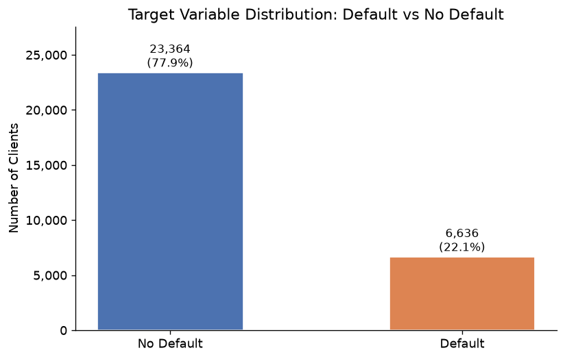
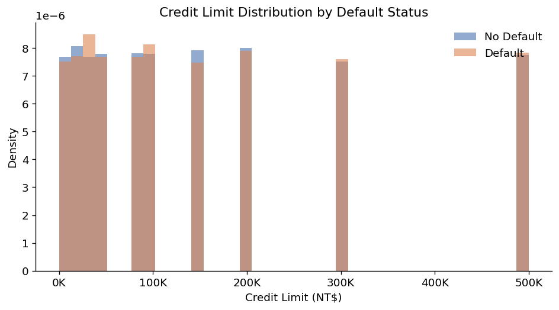

# Credit Card Default Analysis

## Overview
Python analysis of 30,000 credit card client records, focusing on data quality, repayment patterns, and factors associated with default. The project uses a modular workflow for loading, preprocessing, statistical analysis, and visualization.

## Dataset
UCI Default of Credit Card Clients  
https://www.kaggle.com/datasets/uciml/default-card-clients-dataset  
30,000 rows × 25 columns

## Project Structure

```
credit_default_project/
├── main.py                  ← Entry point: runs the full pipeline
├── requirements.txt
├── data/
│   └── UCI_Credit_Card.csv  ← Place the Kaggle CSV here
├── outputs/
│   └── figures/             ← All PNG figures saved here (auto-created)
└── src/
    ├── data_loader.py        ← Module 1: Loading & quality inspection
    ├── preprocessor.py       ← Module 2: Cleaning & feature engineering
    ├── analyzer.py           ← Module 3: Statistical analysis
    └── visualizer.py         ← Module 4: Matplotlib figures
```

## How to Run

### 1. Install dependencies
```bash
pip install -r requirements.txt
```

### 2. Place the dataset
Download `UCI_Credit_Card.csv` from Kaggle and place it in the `data/` folder.  
*(If the file is missing, the script auto-generates a synthetic dataset so the pipeline still runs.)*

### 3. Run the pipeline
```bash
python main.py
```

Or specify a custom path:
```bash
python main.py --data /path/to/UCI_Credit_Card.csv --output my_outputs
```

### 4. Outputs
After running, `outputs/figures/` will contain 9 PNG figures:
| File | Description |
|------|-------------|
| fig1_default_distribution.png | Target class balance |
| fig2_credit_limit_histogram.png | Credit limit by default status |
| fig3_default_by_education.png | Default rate per education group |
| fig4_default_by_age_group.png | Default rate per age bucket |
| fig5_correlation_heatmap.png | Pearson correlation matrix |
| fig6_avg_bill_over_time.png | Monthly bill trend (Apr–Sep) |
| fig7_default_vs_delays.png | Default rate vs consecutive delays |
| fig8_utilisation_vs_payment_ratio.png | Scatter: utilisation vs payment ratio |
| fig9_age_distribution.png | Age distribution by default status |

## Analysis Highlights

### Default Distribution


### Credit Limit by Default Status


### Repayment Delays and Default

