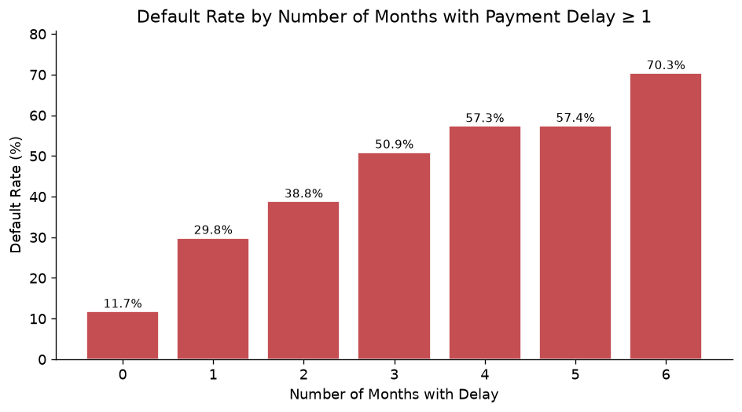

# Credit Card Default Analysis

## Overview
Python analysis of 30,000 credit card client records, focusing on data quality, repayment patterns, and factors associated with default. The project uses a modular workflow for loading, preprocessing, statistical analysis, and visualization.

## Dataset
UCI Default of Credit Card Clients  
(https://www.kaggle.com/datasets/uciml/default-of-credit-card-clients-dataset)
30,000 rows × 25 columns

## Analysis Highlights

### Default Distribution


Of 30,000 clients, 6,636 (22.1%) defaulted. This class imbalance
is important when interpreting results or evaluating future models.

### Credit Limit by Default Status


Clients who defaulted were more concentrated at lower credit limits.
The distributions overlap, so credit limit alone does not separate
defaulters from non-defaulters.

### Repayment Delays and Default


Default rates increased from 11.7% among clients with no delayed
months to 70.3% among those with delays in all six observed months.
This shows an association, rather than evidence of causation.

## Limitations

- This analysis uses historical credit card data from Taiwan;
  findings may not generalize to other populations or current conditions.
- Relationships are observational and do not establish causation.
- Outlier capping changes extreme values and may affect the results.
- This project explores patterns; it does not build or evaluate
  a predictive default model.

## Project Structure

```text
credit-card-default-analysis/
├── main.py              # Runs the full pipeline
├── data_loader.py       # Loads data and checks quality
├── preprocessor.py      # Cleans data and creates features
├── analyzer.py          # Calculates statistical summaries
├── visualizer.py        # Generates charts
├── requirements.txt     # Required Python packages
├── README.md
└── fig*.png             # Charts displayed in this repository
```

The following folders are used when running the project:
- `data/`: Place the downloaded `UCI_Credit_Card.csv` here.
- `outputs/figures/`: Generated charts are saved here automatically.

## How to Run

### 1. Install dependencies
```bash
pip install -r requirements.txt
```

### 2. Place the dataset
Download `UCI_Credit_Card.csv` from Kaggle and place it in the `data/` folder.  
*(If the file is missing, the script auto-generates a synthetic dataset so the pipeline still runs.)*

### 3. Run the pipeline
```bash
python main.py
```

Or specify a custom path:
```bash
python main.py --data /path/to/UCI_Credit_Card.csv --output my_outputs
```

### 4. Outputs
After running, `outputs/figures/` will contain 9 PNG figures:
| File | Description |
|------|-------------|
| fig1_default_distribution.png | Target class balance |
| fig2_credit_limit_histogram.png | Credit limit by default status |
| fig3_default_by_education.png | Default rate per education group |
| fig4_default_by_age_group.png | Default rate per age bucket |
| fig5_correlation_heatmap.png | Pearson correlation matrix |
| fig6_avg_bill_over_time.png | Monthly bill trend (Apr–Sep) |
| fig7_default_vs_delays.png | Default rate vs consecutive delays |
| fig8_utilisation_vs_payment_ratio.png | Scatter: utilisation vs payment ratio |
| fig9_age_distribution.png | Age distribution by default status |


